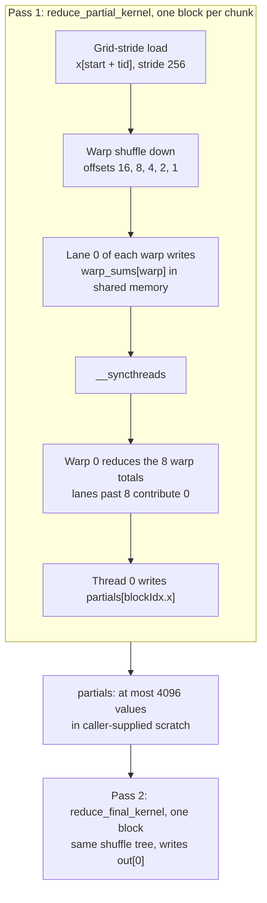
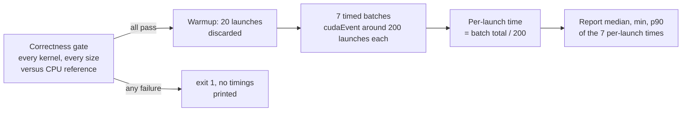

# cuda

[](https://github.com/bniladridas/cuda/actions/workflows/ci.yml)

[](LICENSE)

CUDA C++ kernel engineering: correctness, optimization and reproducible GPU
benchmarks.

Hand-written kernels, checked against CPU references and measured against the
hardware's memory bandwidth limit. No wrappers around vendor libraries: the
point is the kernel, not the call into CUB.

> Two badges, two different claims. **CPU checks** reports the GitHub-hosted
> job: configuration, host-side build and reference checks. **GPU validation:
> pending** is static because no device has run this code. See [Status](#status).

## Status

Two kernels, both implemented end to end:

| Kernel | What it does | Correctness tests | Validated |
| ------ | ------------ | ----------------- | --------- |
| `vecadd` | `c = a + b`, grid-stride | written | **GPU run pending** |
| `reduce` | sum over `float` / `double`, warp-shuffle tree, two passes | written | **GPU run pending** |

Neither kernel has been compiled with `nvcc` or executed on a device yet. No
performance numbers are published: they will be added only after a run on real
hardware with the recorded environment (see
[`docs/methodology.md`](docs/methodology.md)). A CPU-only build proves the tree
configures and the reference maths is right; it does not verify the kernels.

### How `reduce` works

Two passes over the data, so any `n` uses at most 4096 blocks regardless of
size. Both passes share the same block reduction: a warp shuffle tree, the 8
warp totals in shared memory, then a second shuffle tree.



The last block extends to `n`, so the remainder left by ceil-scaled chunks is
never stranded. The result is not bit-reproducible across launch
configurations: float addition is not associative, so a different block count
reorders the sums. Tests compare with a relative tolerance, not for equality.

## Requirements

- CMake 3.24 or newer, and a C++17 compiler with `nvcc`-compatible flags:
  GCC or Clang. The defaults build with `-Wall -Wextra -Wpedantic -Werror`;
  pass `-DCUDA_KERNELS_WERROR=OFF` if a newer compiler is stricter than these.
- Host-side build: any Linux or macOS machine. No CUDA install needed.
- Kernel build and GPU tests: NVIDIA Linux host, compute capability 7.0 or
  newer, driver 525 or newer, CUDA toolkit 12.x with `nvcc` on `PATH`.
- Bash. The build, test and benchmark scripts are shell scripts, so native
  Windows is not supported. macOS can run the host checks but not the kernels:
  there is no CUDA toolchain for it.

Details, including self-hosted runner setup, are in
[`docs/hardware.md`](docs/hardware.md).

## Build

`./runners/build.sh` works on any Linux or macOS machine. Without a CUDA
toolkit it builds the host-side tests only and says so; the kernels are simply
not compiled. With `nvcc` present it compiles the kernels too. It configures as
`Release`, and honours an explicit `CMAKE_BUILD_TYPE` passed through
`CMAKE_ARGS`.

```bash
./runners/build.sh
```

The kernel architecture list is separate. It defaults to `70;75;80;86;89;90`
(Volta through Hopper). Narrow it to the target device to cut build time, for
example `86` on an A10:

```bash
CUDA_KERNELS_ARCH="86" ./runners/build.sh
```

## Test

```bash
./runners/test.sh
```

`test_host` runs anywhere and checks the CPU reference implementations.
`test_vecadd` and `test_reduce` need a GPU; without one they print
`SKIPPED: no CUDA device` and exit 0, so CTest counts them as passed.
**A skip is not a pass.** The runner re-runs each test verbosely, prints
`*** SKIPPED (not a pass)` for any test that skipped, and exits non-zero if
anything actually failed.

Set `GPU_REQUIRED=1` to make a skip a failure. CI uses it on the GPU runner,
which is supposed to have a device.

If a GPU test aborts with "no kernel image is available for execution on the
device", the build does not contain code for that GPU's architecture. The
default list is `70;75;80;86;89;90`; rebuild with the target's value, for
example `CUDA_KERNELS_ARCH="86" ./runners/build.sh`, then run the tests against
the same `BUILD_DIR`.

Covered edge cases: empty input, sub-warp sizes, block boundaries
(255/256/257), grid-stride sizes, odd non-power-of-two lengths, all-zero and
all-one data, large-magnitude values for float precision, and `double`
cancellation.

## Benchmark

```bash
./runners/benchmark.sh
./build/cuda_benchmarks --help
```

The binary verifies every kernel at every size against a CPU reference and
refuses to print timings if any case fails. Results are written as JSON with
the device, driver, toolkit, commit and timestamp recorded. Methodology
(events, warmup, median-of-batches, achieved vs peak bandwidth) is in
[`docs/methodology.md`](docs/methodology.md).

Until a GPU run has been performed, there are no recorded results in this
repository. [`docs/kaggle-run.md`](docs/kaggle-run.md) is the manual procedure
for performing one on a free Kaggle GPU session and capturing the evidence.

Correctness runs before any timing. Each size is then warmed up once and
measured with replicated batches:



The median is the headline figure; min and p90 show spread. A batch is timed
launch-to-completion, so the figure includes what a caller actually pays.

Once a result file exists, plot it against the device's spec-sheet peak:

```bash
PEAK_GBPS=600 ./runners/plot.sh   # writes benchmarks/results/<result>.png
```

`runners/plot.sh` uses the newest file in `benchmarks/results/` and needs
matplotlib (`pip install matplotlib`); it is not a build dependency. With no
result file or no `PEAK_GBPS` it exits 2 and draws nothing. The script has been
exercised against hand-made fixtures only: **no chart here has been produced
from a real device yet.**

There is intentionally no bandwidth chart in this README. The first one will
be added together with the JSON result it was drawn from, so the image can be
traced to a recorded run. Until then, the Status table says `GPU run pending`
and that is the accurate description.

## Layout

```
include/cuda_kernels/   public launcher APIs (no CUDA types in signatures)
src/                    kernel implementations
kernels/                library target
tests/                  host reference checks + GPU correctness tests
benchmarks/             timing harness and benchmark binary
runners/                build / test / benchmark scripts
docs/                   hardware requirements and methodology
```

## CI

- `cpu`: GitHub-hosted, runs on every push. CPU-only configure, build, and
  host reference checks.
- `gpu`: self-hosted NVIDIA Linux runner
  (`self-hosted, linux, x64, nvidia, cuda`), compiles the kernels, runs the
  GPU correctness tests and a benchmark. The test step sets `GPU_REQUIRED=1`, so
  a runner without a working device fails instead of skipping. Gated on the
  repository variable `CUDA_CI_ENABLED=true` so it is skipped, not queued, until
  that hardware is registered; it has never run. Setup in
  [`docs/hardware.md`](docs/hardware.md).
- `codeql`: C/C++ static analysis on the hosted runner, using CodeQL's
  `build-mode: none` so no CUDA toolkit is needed. Two known limitations: it does
  not extract `.cu` files, so `src/vecadd.cu` and `src/reduce.cu` are never
  scanned; and it reported zero results on deliberately planted bounds bugs,
  including one in a scanned `.cpp` file. It covers no kernel code and is not
  relied on as a safety net. It is kept as a scheduled check for when query
  coverage improves.

## Roadmap

Done: vector add, parallel reduction, correctness harness, benchmark harness,
CI.

Next, in order: matrix multiplication and tiling, shared-memory and occupancy
study, profiling-driven optimization, then comparison benchmarks against
vendor-library equivalents.

## License

MIT. See [`LICENSE`](LICENSE).
