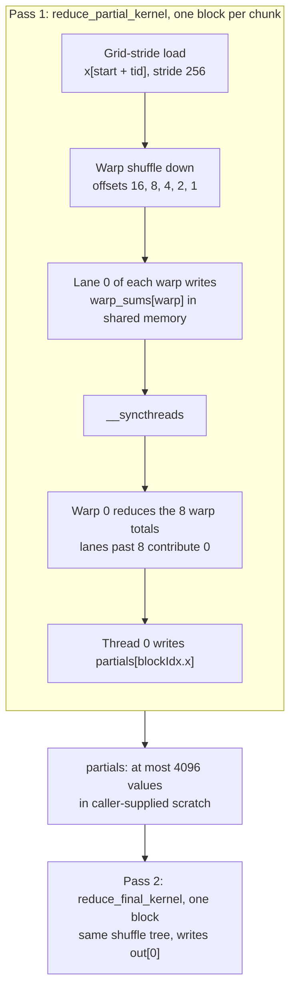
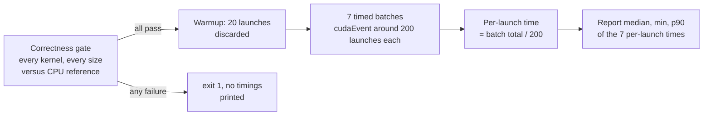

# cuda

[](https://github.com/bniladridas/cuda/actions/workflows/ci.yml)

[](LICENSE)

CUDA C++ kernel engineering: correctness, optimization and reproducible GPU
benchmarks.

Hand-written kernels, checked against CPU references and measured against the
hardware's memory bandwidth limit. No wrappers around vendor libraries: the
point is the kernel, not the call into CUB.

> Two badges, two different claims. **CPU checks** reports the GitHub-hosted
> job: configuration, host-side build, reference checks, formatting, and host
> static analysis. The separate CUDA compile job builds device code without a
> GPU. **GPU validation: pending** is static because no device has
> run this code. See [Status](#status).

## Status

Seven kernels, implemented with CPU references and GPU tests:

| Kernel | What it does | Correctness tests | Validated |
| ------ | ------------ | ----------------- | --------- |
| `vecadd` | `c = a + b`, grid-stride | written | **GPU run pending** |
| `reduce` | sum over `float` / `double`, warp-shuffle tree, two passes | written | **GPU run pending** |
| `softmax` | stable row-wise FP32 normalization, one block per row | written | **GPU run pending** |
| `gemm` | row-major FP32 matrix multiplication, 16×16 shared-memory tiles | written | **GPU run pending** |
| `int8_gemm` | signed int8 matrix multiplication with int32 accumulation | written | **GPU run pending** |
| `layernorm` | row-wise FP32 normalization with population variance | written | **GPU run pending** |
| `attention` | staged non-causal single-head FP32 scaled dot-product attention | written | **GPU run pending** |

The hosted `cuda-compile` job compiles the CUDA sources with `nvcc`, but no
kernel has been executed on a device yet. No performance numbers are published:
they will be added only after a run on real hardware with the recorded
environment (see
[`docs/methodology.md`](docs/methodology.md)). A CPU-only build proves the tree
configures and the reference maths is right; it does not verify the kernels.

### How `softmax` works

One CUDA block processes each row. Threads make strided passes to find the row maximum, sum the max-subtracted exponentials, and write normalized values. Warp shuffles and shared memory combine the eight warp partials. Arbitrary positive widths are supported, including widths that are not powers of two. Empty dimensions are no-ops.

### How `layernorm` works

One CUDA block processes each row. It computes the row mean, then the population variance in a second pass, and applies `(x - mean) / sqrt(variance + epsilon) * gamma + beta`. The default epsilon is `1e-5`; callers may provide another finite positive value. Invalid epsilon aborts under the library's fail-fast error policy. The output must not overlap input, gamma, or beta. Arbitrary positive feature widths are supported.

### How `int8_gemm` works

A portable scalar CUDA path computes one output per thread and accumulates signed int8 products in int32. The supported reduction length is limited to 131071 so every possible int8 input pair remains within the signed int32 range. For symmetric per-tensor quantization with zero-points fixed at zero, callers dequantize the accumulator with the product of the two input scales. No architecture-specific integer matrix instruction or inference-runtime compatibility is claimed.

### How `gemm` works

One CUDA block computes a 16×16 output tile. Threads cooperatively load A and B tiles into shared memory, accumulate dot products with FP32 fused multiply-add, and mask partial edge tiles. The row-major launcher accepts an explicit stream and treats zero dimensions as no-ops.

### How `reduce` works

Two passes over the data, so any `n` uses at most 4096 blocks regardless of
size. Both passes share the same block reduction: a warp shuffle tree, the 8
warp totals in shared memory, then a second shuffle tree.



The last block extends to `n`, so the remainder left by ceil-scaled chunks is
never stranded. The result is not bit-reproducible across launch
configurations: float addition is not associative, so a different block count
reorders the sums. Tests compare with a relative tolerance, not for equality.

## Public API contract

The launchers are asynchronous and report immediate launch failures using a fail-fast check. Callers must synchronize the relevant stream before consuming results. See [`docs/api.md`](docs/api.md) for the error-reporting details and a usage example.

## Requirements

- CMake 3.24 or newer, and a C++17 compiler with `nvcc`-compatible flags:
  GCC or Clang. Host C++ targets build with `-Wall -Wextra -Wpedantic` and,
  unless `-DCUDA_KERNELS_WERROR=OFF` is passed, `-Werror`. CUDA host compilation
  gets `-Wall -Wextra` through `-Xcompiler`; `-Wpedantic` is host-only.
- Host-side build: any Linux or macOS machine. No CUDA install needed.
- Kernel build and GPU tests: NVIDIA Linux host, compute capability 7.0 or
  newer, driver 525 or newer, CUDA toolkit 12.x with `nvcc` on `PATH`.
- Python 3 for benchmark JSON validation and selecting the newest result when
  plotting. The benchmark runner checks for it before probing or running the GPU.
  Plotting also needs matplotlib (`pip install matplotlib`).
- Bash. The build, test and benchmark scripts are shell scripts, so native
  Windows is not supported. macOS can run the host checks but not the kernels:
  there is no CUDA toolchain for it.

Details, including self-hosted runner setup, are in
[`docs/hardware.md`](docs/hardware.md).

## Build

`./runners/build.sh` works on any Linux or macOS machine. Without a CUDA
toolkit it builds the host-side tests only and says so; the kernels are simply
not compiled. With `nvcc` present it compiles the kernels too. It configures as
`Release`, and honours an explicit `CMAKE_BUILD_TYPE` passed through
`CMAKE_ARGS`.

```bash
./runners/build.sh
```

The kernel architecture list is separate. It defaults to `70;75;80;86;89;90`
(Volta through Hopper). Narrow it to the target device to cut build time, for
example `86` on an A10:

```bash
CUDA_KERNELS_ARCH="86" ./runners/build.sh
```

## Test

```bash
./runners/test.sh
```

`test_host` runs anywhere and checks the CPU reference implementations.
`test_vecadd`, `test_reduce`, `test_softmax`, `test_gemm`, `test_layernorm`, and `test_attention` need a GPU. A successful device query that
reports zero devices, or CUDA's explicit `cudaErrorNoDevice`, prints
`SKIPPED: no CUDA device` and exits 0, so CTest counts them as passed.
Other `cudaGetDeviceCount` failures, including insufficient-driver and
initialization errors, print the CUDA diagnostic and exit non-zero.
**A skip is not a pass.** The runner invokes CTest once with verbose
output, reports any GPU test that emitted `SKIPPED` as
`*** SKIPPED (not a pass)`, and exits non-zero if anything actually failed.
It does not execute tests a second time.

Set `GPU_REQUIRED=1` to make a skip a failure. CI uses it on the GPU runner,
which is supposed to have a device.

If a GPU test aborts with "no kernel image is available for execution on the
device", the build does not contain code for that GPU's architecture. The
default list is `70;75;80;86;89;90`; rebuild with the target's value, for
example `CUDA_KERNELS_ARCH="86" ./runners/build.sh`, then run the tests against
the same `BUILD_DIR`.

Layer-normalization tests cover constant rows, single-feature rows, large magnitudes, irregular feature widths, and a non-default stream. Attention tests compare the scaled score matrix, normalized probability matrix, and final output against a double-precision CPU reference, including unequal sequence lengths and challenging logits.

Softmax tests cover empty dimensions, one-column rows, uniform rows, large positive and negative logits, mixed magnitudes, irregular widths, multiple rows, and a non-default stream. GEMM tests cover scalar, rectangular, partial 16×16 edge tiles, K-edge cases, and a non-default stream.

Covered reduction edge cases: empty input, sub-warp sizes, block boundaries
(255/256/257), grid-stride sizes, odd non-power-of-two lengths, all-zero and
all-one data, large-magnitude values for float precision, and `double`
cancellation.

## Benchmark

```bash
./runners/benchmark.sh
./build/cuda_benchmarks --help
bash ./runners/gemm-benchmark.sh
bash ./runners/layernorm-benchmark.sh
./build/cuda_attention_benchmarks
```

The existing binary benchmarks vector add and reduction. The separate GEMM
benchmark checks each matrix shape against the CPU reference before timing and
records M, N, K, tile shape, GPU, driver, CUDA runtime, commit and UTC timestamp
in JSON. The LayerNorm benchmark checks three representative row/feature shapes against the double-precision CPU reference before timing and records shape, epsilon, median/min/p90 latency, GPU, compute capability, driver, CUDA runtime, commit and UTC timestamp in JSON. No result is recorded until it runs on an NVIDIA device. Methodology is in [`docs/methodology.md`](docs/methodology.md).

Until a GPU run has been performed, there are no recorded results in this
repository. [`docs/kaggle-run.md`](docs/kaggle-run.md) is the manual procedure
for performing one on a free Kaggle GPU session and capturing the evidence.

Correctness runs before any timing. Each size is then warmed up once and
measured with replicated batches:



The median is the headline figure; min and p90 show spread. A batch is timed
launch-to-completion, so the figure includes what a caller actually pays.

Once a result file exists, plot it against the device's spec-sheet peak:

```bash
PEAK_GBPS=600 ./runners/plot.sh   # writes benchmarks/results/<result>.png
```

`runners/plot.sh` uses the newest file in `benchmarks/results/` and needs
matplotlib (`pip install matplotlib`); it is not a build dependency. With no
result file or no `PEAK_GBPS` it exits 2 and draws nothing. The script has been
exercised against hand-made fixtures only: **no chart here has been produced
from a real device yet.**

There is intentionally no bandwidth chart in this README. The first one will
be added together with the JSON result it was drawn from, so the image can be
traced to a recorded run. Until then, the Status table says `GPU run pending`
and that is the accurate description.

## Layout

```
include/cuda_kernels/   public launcher APIs (no CUDA types in signatures)
src/                    kernel implementations
kernels/                library target
tests/                  host reference checks + GPU correctness tests
benchmarks/             timing harness and benchmark binaries
pr-confidence/          pr-evidence engine and its offline tests
pr-scope-guard/         read-only PR title scope and changed-file check
runners/                build / test / benchmark scripts
docs/                   hardware, methodology, C++ quality, PR evidence, label review, pr-scope-check and repository report architecture
label-review/           reusable issue label review engine and tests
format-repair/          approval-gated C/C++/CUDA and Python formatting repair
issue-landing/          issue landing report engine and offline tests
squash-merge/           maintainer-approved squash-merge policy engine and tests
rebase-agent/           safe PR rebase and bounded repair engines with tests
```

## CI

- `cpu`: GitHub-hosted, runs on every push and pull request. Checks repository
  YAML with yamllint and GitHub Actions workflows with actionlint, runs the
  host-only CMake build and reference tests, verifies GPU binaries are absent,
  checks runner skip handling, formats C++/CUDA sources, and runs host-side
  clang-tidy. It also runs offline tests for label review, issue landing, PR
  evidence, pr-scope-check, format repair, squash-merge policy, and the
  rebase safety, merge integration, tree inspection, and bounded repair engines.
  CUDA sources are formatted but not compiled or analyzed here.
- `python`: GitHub-hosted, runs Ruff lint and format checks, coverage, and the
  selected Python suites: PR evidence, label review, pr-scope-check, format
  repair, squash-merge, rebase-agent, and benchmarks. Issue-landing tests run in
  the CPU job. Dependency versions are pinned in
  `requirements-dev.txt`; coverage is reported without a pass threshold. No CUDA
  toolkit is required.
- `cuda-compile`: GitHub-hosted Ubuntu 22.04 container using the pinned
  `nvidia/cuda:12.6.3-devel-ubuntu22.04` image and CMake 3.31.6. It compiles the
  kernel library, all GPU test executables, and the benchmark for architectures
  70, 75, 80, 86, 89, and 90. It does not execute tests or require an NVIDIA
  device. This is compile evidence only, not GPU runtime validation.
- `pr-evidence`: triggered by pull request activity, waits for the configured
  checks, and publishes a read-only `pr-evidence` summary in the Checks UI. It
  uses `pull_request_target`, so the workflow and engine come from the base
  branch; it never checks out pull request code and uses a read-only token with
  no secrets. Treat the score as advisory alongside the checks it reads. The
  check activates for later pull requests after this workflow merges. Rubric and
  setup in [`docs/pr-confidence.md`](docs/pr-confidence.md).
- `format-repair`: read-only C/C++/CUDA and Python formatting reports on pull-request activity;
  formatting commits require the `format-fix:approved` label from an
  authorized maintainer. Fork PRs remain report-only. It never approves or
  merges a pull request. Details in `docs/format-repair.md`.
- `pr-scope-check`: read-only and advisory. On pull request activity it
  compares the title's declared scope with the changed files using
  `.github/pr-scopes.json` and `.github/pr-scope-guard.yml`, then writes a
  summary and JSON artifact. It never comments, labels, approves, blocks or
  merges. Findings do not fail the check.
- `squash-merge`: explicit maintainer approval via `squash-merge:approved` triggers a guarded squash-only merge attempt. It validates the maintainer, same-repository target, exact head SHA, independent reviewer approval, and observed checks. GitHub remains authoritative for branch protection and required checks. Formatting approval never authorizes a merge. Setup in [`docs/squash-merge.md`](docs/squash-merge.md).

- `pr-lock`: runs when a pull request closes and locks the conversation
  with reason `resolved` only when the pull request was merged. It uses
  `pull_request_target` so the workflow comes from the base branch, needs only
  `issues: write`, and checks out no code. Unmerged closed pull requests remain
  unlocked.
- `gpu`: self-hosted NVIDIA Linux runner
  (`self-hosted, linux, x64, nvidia, cuda`), compiles the kernels, runs the
  GPU correctness tests and a benchmark. The test step sets `GPU_REQUIRED=1`, so
  a runner without a working device fails instead of skipping. Gated on the
  repository variable `CUDA_CI_ENABLED=true` so it is skipped, not queued, until
  that hardware is registered; it has never run. Setup in
  [`docs/hardware.md`](docs/hardware.md).
- `codeql`: C/C++ static analysis on the hosted runner, using CodeQL's
  `build-mode: none` so no CUDA toolkit is needed. Two known limitations: it does
  not extract `.cu` files, so `src/vecadd.cu` and `src/reduce.cu` are never
  scanned; and it reported zero results on deliberately planted bounds bugs,
  including one in a scanned `.cpp` file. It covers no kernel code and is not
  relied on as a safety net; the CPU job's host-side clang-tidy is complementary
  and covers `tests/test_host.cpp` and the CUDA-free public headers only. CodeQL
  is kept as a scheduled check for when query coverage improves.

## Review automation

- `codex-review`: apply `codex:review` to request a Codex PR review. The workflow posts `@codex review` and consumes the label after posting. Codex must be connected and enabled; confirm that it responds to a bot-authored command comment during the first smoke test. Setup in [`docs/codex-review.md`](docs/codex-review.md).
- `pr-rebase`: an authorized maintainer can apply `rebase:approved` to update an open, non-draft, same-repository PR targeting `main`. The workflow verifies the exact PR head and base state, then asks GitHub to update the branch. It uses a write-scoped rebase token and GitHub's signed update commit; it does not merge the PR.
- `issue-report`: after a PR is merged, generates an auditable report for linked issues and posts it as an issue comment. A manual dispatch can generate a report for one issue. Closing is a separate, optional path requiring the repository variable, an approved report digest, and the protected `issue-landing-close` environment. See [`issue-landing/`](issue-landing/).

## Roadmap

The language and architecture audit is in [`docs/language-roadmap.md`](docs/language-roadmap.md).
CUDA C++ remains the implementation core. C interoperability and Fortran are
separate, evidence-gated follow-up tracks, not additional implementations in
the current build.

Next GEMM work: profile the initial tiled kernel, study tile sizes and
occupancy, then add profiling-driven optimization and separately measured
vendor-library comparison benchmarks. GPU-dependent work remains pending a
recorded NVIDIA device run.

## License

MIT. See [`LICENSE`](LICENSE).
